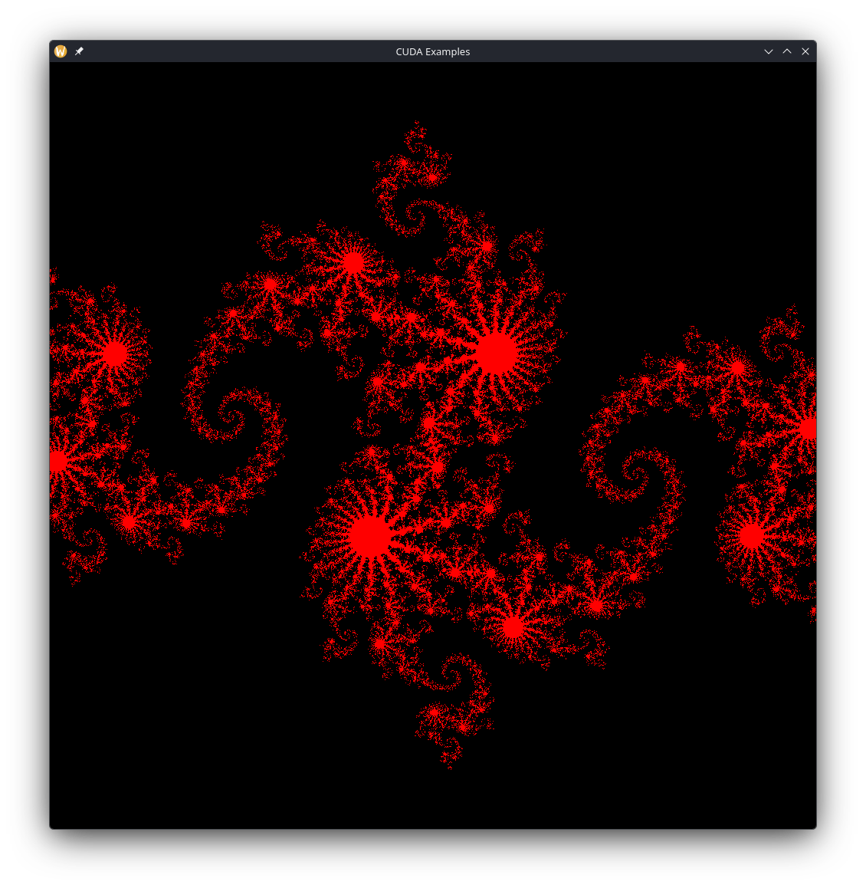

* Julia set

Based on the example from Chapter 4.4 in [[https://developer.nvidia.com/cuda-example][CUDA by example]], this example implements calculating the [[https://en.wikipedia.org/wiki/Julia_set][Julia set]] on the GPU and uses the same fundamental CUDA code found in the [[https://github.com/KaiRJ/CUDA-examples/tree/main/VectorSum][Vector sum]] example but in a more interesting setting.

