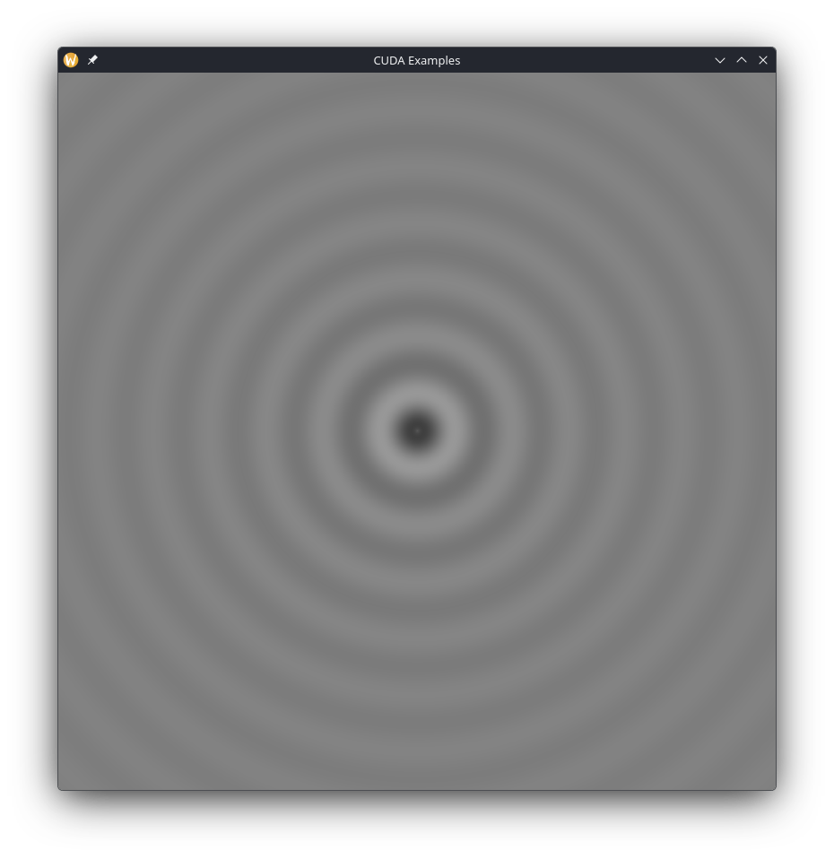

* Ripple

Based on the example from Chapter 5.2 in [[https://developer.nvidia.com/cuda-example][CUDA by example]], this example animates a ripple effect on the GPU utilising a combination of blocks and threads for greater efficiency.

